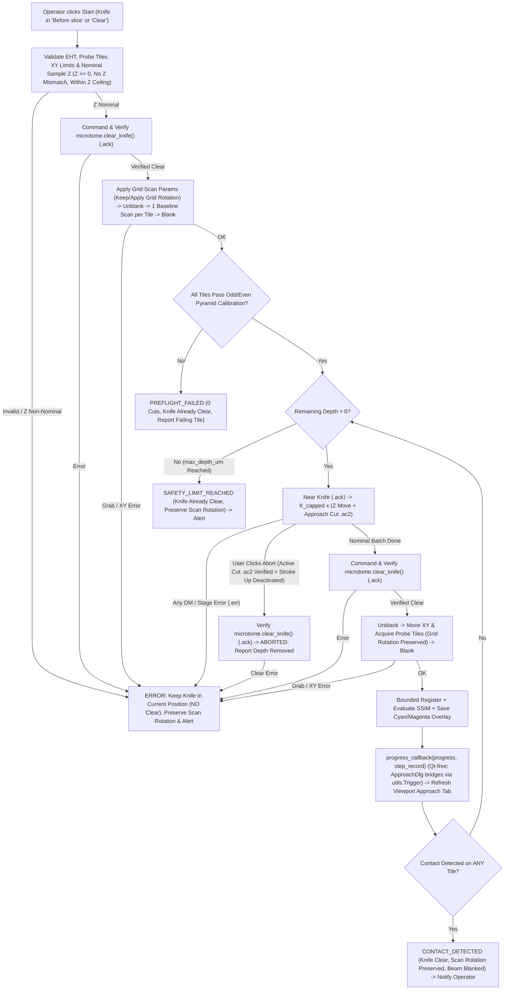

# Automated Sample Approach (`auto-approach`) — Feature Architecture

## 1. Overview & Motivation
Operators need to approach the diamond knife to the block surface both after initial sample mounting (post coarse air-approach) and during dataset acquisition whenever a pause, chamber vent, thermal drift, or cutting issue requires an automated **re-approach**. Legacy `ApproachDlg` only performs blind slice batches (`N` slices at `T` nm without imaging) and unconditionally clears the knife on exit. `auto-approach` introduces a Qt-free, threshold-free, self-calibrating engine (`src/auto_approach.py`) for **Gatan 3View** systems, paired with a non-modal tabbed `ApproachDlg` and a dedicated 4th `Approach` tab in `SBEMimage Viewport` displaying contrast-matched Cyan/Magenta series overlays.

---

## 2. Mathematical Architecture

### 2.1 Single-Scan Odd/Even Scan-Line Self-Calibration & Pyramid Scale Selection
Given a single baseline grayscale tile $I_0 \in \mathbb{R}^{H \times W}$:

1. **Pre-Flight Validity Gate:**
   Reject immediately if grab failed/incomplete, $\mu(I_0) \le 1.0$, $\mu(I_0) \ge 254.0$, or $\sigma(I_0) < 0.5$.
2. **Half-Pixel Aligned Even/Odd Raster Split:**
   Let $M = \lfloor H / 2 \rfloor$. Extract temporally independent scan-line sub-images:
   $$E_0 = I_0[0:2M:2,\; :], \qquad O_0 = I_0[1:2M:2,\; :]$$
   Row $r$ of $E_0$ sits at original row $y = 2r$ and row $r$ of $O_0$ at $y = 2r + 1$. Align both onto the common original-row lattice $y = 2r + 1.5$ via mirror-symmetric $2$-tap vertical interpolation on common rows $r = 0 \dots M-2$:
   $$\tilde{E}_0[r, :] = \tfrac{1}{4} E_0[r, :] + \tfrac{3}{4} E_0[r+1, :], \qquad \tilde{O}_0[r, :] = \tfrac{3}{4} O_0[r, :] + \tfrac{1}{4} O_0[r+1, :]$$
   Centroids: $\tilde{E}_0$: $\tfrac{1}{4}(2r) + \tfrac{3}{4}(2r+2) = 2r + 1.5$; $\tilde{O}_0$: $\tfrac{3}{4}(2r+1) + \tfrac{1}{4}(2r+3) = 2r + 1.5$ — **exact coincidence**. The two kernels are mirror images about $y = 2r + 1.5$ (offsets $\{-1.5: \tfrac{1}{4},\, +0.5: \tfrac{3}{4}\}$ vs. $\{-0.5: \tfrac{3}{4},\, +1.5: \tfrac{1}{4}\}$), so both halves have **identical noise variance** $\big(\tfrac{3}{4}\big)^2 + \big(\tfrac{1}{4}\big)^2 = \tfrac{5}{8}$ and **identical MTF** (magnitude response), while $\tilde{E}_0$ and $\tilde{O}_0$ remain built from disjoint, temporally independent raster lines. *(Unit-test invariant: on a synthetic image with a single bright row, the centroids of $\tilde{E}_0$ and $\tilde{O}_0$ must coincide to $< 10^{-9}$ px.)*
3. **$2\times$ Area-Averaging Pyramid:**
   For pyramid level $l = 0, 1, \dots, L_{\max}$ (while $\min(H_l, W_l) \ge 64$), downsample by $2\times 2$ block averaging:
   $$P_l(X)[i, j] = \frac{1}{4}\sum_{u=0}^{1}\sum_{v=0}^{1} P_{l-1}(X)[2i+u, 2j+v]$$
   Shot noise std decays by $2^{-l}$ per level ($+6\,\text{dB}$ SNR per octave).
4. **Scale $l^*$ & Cut Boundary Calibration:**
   Evaluate $\text{SSIM}_{\text{internal}}(l) = \mathcal{S}_m\big(P_l(\tilde{E}_0),\, P_l(\tilde{O}_0)\big)$ under the active SSIM mode $m \in \{0, 1\}$:
   - Choose the smallest $l^*$ such that $\text{SSIM}_{\text{internal}}(l^*) \ge 0.94$.
   - If $\max_l \text{SSIM}_{\text{internal}}(l) \in [0.85, 0.94)$, select $l^* = \arg\max_l \text{SSIM}_{\text{internal}}(l)$.
   - If $\max_l \text{SSIM}_{\text{internal}}(l) < 0.85$, mark tile `valid = False` (insufficient surface SNR / featureless noise) and abort **before cutting any slices**.
   - Define noise dissimilarity $d_{\text{noise}} = 1 - \text{SSIM}_{\text{internal}}(l^*)$ and self-calibrated cut dissimilarity limit:
     $$d_{\text{trigger}} = \min\big(\max(4.0 \cdot d_{\text{noise}},\; 0.12),\; 0.45\big)$$

---

### 2.2 Bounded-Shift Subpixel Registration
For consecutive full frames $(I_{k-1}, I_k)$ projected to tile $t$'s calibrated pyramid level $l^*$ ($A = P_{l^*}(I_{k-1})$, $B = P_{l^*}(I_k)$):
1. Compute subpixel shift $(\Delta y, \Delta x)$ via `phase_cross_correlation(A, B, upsample_factor=10)`.
2. Bound maximum physical stage wander to $W_{\max} = 5.0\,\mu\text{m}$ and $\le 15\%$ of image dimensions:
   $$s_{\max} = \max\left(2,\; \min\left(\left\lceil \frac{5000.0}{\text{pixel\_size\_nm} \cdot 2^{l^*}} \right\rceil,\; \lfloor 0.15 \cdot \min(H_{l^*}, W_{l^*}) \rfloor\right)\right)$$
   If $|\Delta y| > s_{\max}$ or $|\Delta x| > s_{\max}$ (e.g. correlation collapse when $100\%$ of the tile was shaved clean), clamp $(\Delta y, \Delta x)$ to $(0.0, 0.0)$ and crop a safe margin $c = 2\,\text{px}$ so array dimensions remain intact and loss of structure registers cleanly as $d_k \to 1$.
3. Otherwise apply `scipy.ndimage.shift(B, (dy, dx), order=1)` and crop interior overlap by $(\lceil |\Delta y| \rceil + 1, \lceil |\Delta x| \rceil + 1)$.

---

### 2.3 Dual PoC SSIM Modes ($\mathcal{S}_m$)
Given registered crops $(U, V)$:
- **Mode 0 — Z-Score Normalized SSIM (`SSIMMode.NORMALIZED`):**
  $$\hat{U} = \operatorname{clip}\!\left(\frac{U - \mu_U}{\max(\sigma_U, 10^{-6})},\; -4.0,\; 4.0\right), \quad \hat{V} = \operatorname{clip}\!\left(\frac{V - \mu_V}{\max(\sigma_V, 10^{-6})},\; -4.0,\; 4.0\right)$$
  $$\mathcal{S}_0(U, V) = \operatorname{SSIM}(\hat{U}, \hat{V};\; \text{data\_range}=8.0)$$
  *Note:* At $k \ge 1$, if $\sigma_U$ was valid at $k-1$ and the knife shaves $V$ into smooth resin ($\sigma_V \ll \sigma_U$), scaling $\hat{V}$ by $\max(\sigma_V, 0.25 \cdot \sigma_U)$ prevents amplifying shot noise while ensuring structure covariance drops sharply.
- **Mode 1 — Spatial Gradient Magnitude SSIM (`SSIMMode.GRADIENT`):**
  Compute Sobel gradient magnitudes $G_U = \sqrt{(S_x * U)^2 + (S_y * U)^2}$ and $G_V = \sqrt{(S_x * V)^2 + (S_y * V)^2}$, normalize each by $\max(\text{P}_{99}(G), 10^{-6})$ onto $[0, 1]$, and evaluate:
  $$\mathcal{S}_1(U, V) = \operatorname{SSIM}(\tilde{G}_U, \tilde{G}_V;\; \text{data\_range}=1.0)$$

Contact is declared on step $k \ge 1$ as soon as **any** probe tile satisfies $1 - \mathcal{S}_m(U, V) \ge d_{\text{trigger}}$.

---

### 2.4 Contrast-Matched Cyan/Magenta Overlay Compositing
To render visual differences free of dose-induced brightness tinting and free of white-highlight clipping:
1. Register full-resolution (or display-resolution $\le 1024\,\text{px}$ wide) $I_k$ to $I_{k-1}$ using the scaled shift $(2^{l^*}\Delta y, 2^{l^*}\Delta x)$.
2. Match contrast of $I_k^{\text{reg}}$ to $I_{k-1}^{\text{reg}}$ via robust median/IQR normalization mapped onto $[0, 255] \subset \text{uint8}$ ($\tilde{A}$ = Previous, $\tilde{B}$ = Current).
3. Form the RGB composite:
   $$R = \tilde{B}, \qquad G = \tilde{A}, \qquad B = \max(\tilde{A}, \tilde{B})$$
   - **Unchanged regions ($\tilde{A} = \tilde{B}$):** $R = G = B = \tilde{A}$ (exact neutral grayscale across full $[0, 255]$ dynamic range).
   - **Pre-cut features shaved away ($\tilde{A} > \tilde{B}$):** Pure **Cyan** (`#00FFFF`).
   - **Newly exposed cut boundaries / marks ($\tilde{B} > \tilde{A}$):** Pure **Magenta** (`#FF00FF`).

---

## 3. Gatan 3View Hardware & Non-Destructive Safety Pipeline (Unmodified `dm/*.s`)

### Non-Destructive Invariants
1. **Unmodified DM Scripts:** `dm/SBEMimage_DMcom_GMS2.s` and `dm/SBEMimage_DMcom_GMS3.s` are strictly unmodified.
2. **Start from `'Before slice'` with Nominal-Z Gate:** Starting with `Clear` inactive (`'Before slice'`) is supported; sample Z-axis MUST be verified nominal first (`Z >= 0`, no `Error.mismatch_z`, within Z ceiling) before issuing `clear_knife()` prior to baseline XY moves and imaging.
3. **Error Freeze (Zero Auto-Clear):** Whenever any hardware, stage, Z-mismatch, DM `.err`/timeout, or SEM error occurs, execution halts immediately with **no `clear_knife()` call**, leaving the knife in its current location.
4. **User Abort (Clear After `'Stroke Up'` Deactivation):** Clicking `Abort` immediately halts scheduling further slices; once any active `MicrotomeStage_FullApproachCut` finishes `.ac2` (`Error.none`, confirming `'Stroke Up'` has been deactivated and the sample is lowered below cutting level), `clear_knife()` is commanded and verified (`.ack`), and total depth removed is reported.
5. **Scan-Rotation Preservation:** Scan rotation is never reset to `0`; it preserves pre-approach state or applies each probe tile's parent Grid scan rotation `(360 - theta_grid) % 360`.

---

## 4. GUI & Viewport Architecture
1. **`ApproachDlg` (`gui/approach_dlg.ui`, `src/main_controls_dlg_windows.py`):**
   - Non-modal `QDialog` managed as a single instance on `MainControls`; emits `RESTRICT GUI` / `UNRESTRICT GUI` during active cutting/imaging.
   - `QTabWidget` with **Manual** (legacy blind controls, also updated to respect error knife-freeze and safe abort rules) and **Automated** (batch slices, thickness, max depth µm, live-synced `Reference tiles:` `"g.t"` `QLineEdit` matching `AutofocusSettingsDlg`, dwell time override combo, SSIM mode combo, progress bar, status label, Start/Abort).
2. **Viewport 4th Tab `Approach` (`tab_ap`, prefix `ap_` in `src/viewport.py`):**
   - Responsive $R \times C$ grid on `QLabel_ApproachCanvas` displaying all probe tiles simultaneously with subtle header badges (`Tile g.t | Step k | ΔZ µm` and green/magenta border on cut trigger).
   - `wheelEvent` scrubs step index $0 \dots K$; `mouseDoubleClickEvent` toggles single-tile zoom vs. multi-tile grid; compact bottom toolbar provides step slider, `Cyan-Magenta / Raw` toggle, and archived run selector (`meta/approach/<timestamp>/`).
